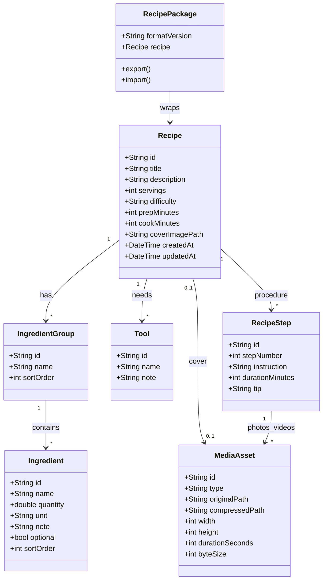
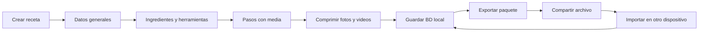

# Savori — Arquitectura

App React Native (Expo) offline-first para guardar y compartir recetas como documentos portables (`.savori`).

## Decisiones

- **Stack:** React Native + Expo
- **BD:** SQLite (`expo-sqlite`) en el dispositivo
- **Media:** archivos locales comprimidos; la BD solo guarda metadatos y paths
- **Intercambio:** paquete ZIP `.savori` con `recipe.json` + `media/`
- **Sin backend** en el MVP

## Diagrama de clases



## Flujos MVP



## Capas del código

| Carpeta | Rol |
|---------|-----|
| `src/domain` | Tipos del dominio |
| `src/data` | SQLite, repositorio, media, export/import |
| `src/features/recipes` | Pantallas del flujo de recetas |
| `src/navigation` | React Navigation |
| `src/theme` | Tokens visuales |

## Política de media

- Fotos: resize máx. 1280px, JPEG ~82%
- Videos: se copian al sandbox con límite de duración en el picker (60s)
- Paths en SQLite; archivos en `documentDirectory/savori-media/`

## Formato `.savori`

```
recipe.json
media/
  cover-....jpg
  <media-id>.jpg|mp4
```

`recipe.json` incluye `formatVersion`, `exportedAt` y el grafo completo de la receta con paths relativos a `media/`.
